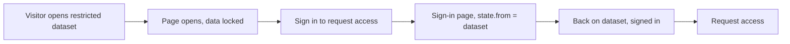
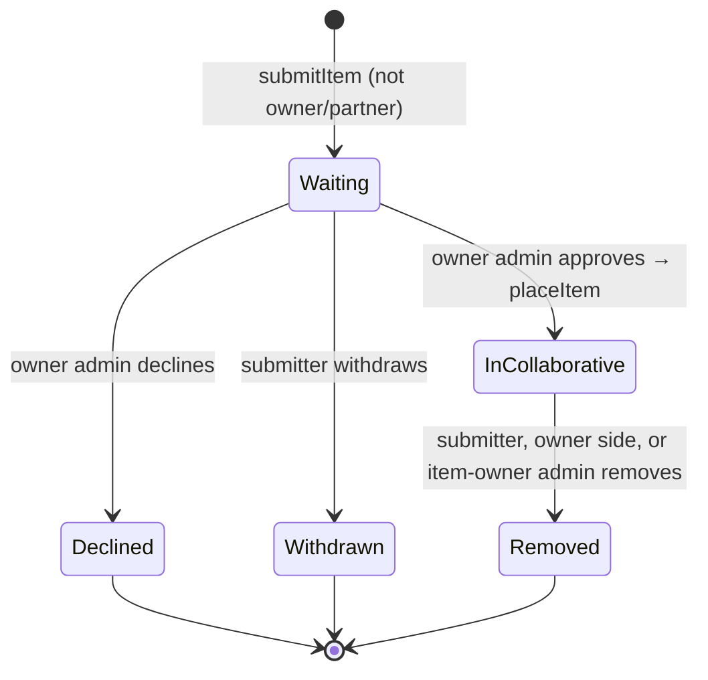

# CivicDataSpace — Platform Roles, Permissions & User Journey Audit

**Date:** 2026-11-16 · **Branch:** `feat/notification-system` (working tree, uncommitted) · **Method:** read-only static reading of the code. No source file was changed; this document is the only file added.

## 0. How to read this report

**What this is.** A reverse-engineering of how CivicDataSpace decides who can see, create, edit, publish, delete, contribute and approve, based on the code as it is today, not on product descriptions.

**The most important thing to know first.** CivicDataSpace today is a front-end prototype with **no backend and no real identity**. Everything below is enforced (or not) only in the browser, over mock data held in React state and `localStorage`. That has two consequences that run through the whole report:

1. "Permission" means *a UI rule in a function or component*. Nothing is enforced at data or server level, because there is no server. Section 10 separates this clearly.
2. The prototype contains **two unconnected pictures of "who the current user is"** (the workspace's fixed user `me` and the notification system's switchable personas). Most inconsistencies in this report come from those two pictures disagreeing. See finding **C1**.

**Evidence labels used throughout**

| Label | Meaning |
| :-- | :-- |
| **Code** | Implemented as logic in a function, hook or reducer |
| **UI** | Only visible in what a screen shows or hides |
| **Backend** | Enforced by server or data layer. **None exists**, so this label never applies |
| **Intended** | Stated in `docs/` or a code comment but not (fully) built |
| **Unverified** | I did not read enough code to say; listed in section 10.5 |

**Status labels in the matrix:** Allowed · Restricted · Conditional · Not supported · Unclear.

**Files most relied on** (paths are relative to the repo root)

| Area | File |
| :-- | :-- |
| Session | `src/context/AuthContext.tsx` |
| Route guard and routes | `src/App.tsx` |
| Org roles and permission functions | `src/types/organisation-workspace.ts`, `src/lib/organisation-permissions.ts`, `src/hooks/use-organisation.ts` |
| Org and content data | `src/context/AppDataContext.tsx`, `src/lib/mock-organisation-workspaces.ts` |
| Ownership, access, collaborative rules | `src/lib/notification-model.ts`, `src/lib/notification-personas.ts`, `src/context/NotificationsContext.tsx`, `src/types/notifications.ts` |
| Lifecycle | `src/lib/content-status.ts` |
| Spec of intent | `docs/restricted-access-and-approvals.md`, `docs/notification-system.md` |

---

## 1. Platform user and role architecture

### 1.1 The roles that exist

There is **no single role system**. There are five separate things that behave like roles, stored in different places and never reconciled.

| # | Role family | Values | Stored / derived where | Scope |
| :-- | :-- | :-- | :-- | :-- |
| 1 | **Signed-in or not** | signed in / signed out | `localStorage['civicdataspace:session'] === 'signed-in'` (`AuthContext.tsx:7-17`). A single boolean. No user id, no email, no token | Global |
| 2 | **Organisation role** (workspace) | `admin`, `editor`, `evaluator` | `OrganisationMember.role` inside `OrganisationRecord.members` (`types/organisation-workspace.ts:9`), in `AppDataContext` state, seeded from `mock-organisation-workspaces.ts` | Per organisation |
| 3 | **Organisation role** (notification system) | `admin`, `editor`, `viewer`, `auditor` | `Persona.memberships[].role` (`types/notifications.ts`, `OrgRole`), hard-coded in `lib/notification-personas.ts` | Per organisation |
| 4 | **Collaborative role** | `owner`, `partner`, `none` | **Derived** by `collaborativeRole()` (`notification-model.ts:84-89`) from the collaborative's owner record (`DEMO_COLLABORATIVES` or the record's `organisationId`), a partner list, and the person's org memberships | Per collaborative |
| 5 | **Item relationship** | item owner, requester, decider, follower, contributor | Derived (see 1.3) | Per item or per collaborative |

The spec document names organisation roles **admin, editor, viewer, auditor** (`docs/restricted-access-and-approvals.md:12,21-28`). The code that powers the Members page uses **admin, editor, evaluator**. They are different vocabularies, not synonyms (finding **C2**).

### 1.2 Who "the current user" is

| Picture | Used by | Who it is | Where |
| :-- | :-- | :-- | :-- |
| **Workspace user `me`** | Organisation workspace pages, My Organisations, org sidebar | One fixed person: John Doe, who is **Admin** of CivicDataLab (`org-workspace-1`) and a member of no other organisation | `CURRENT_USER_PERSON_ID = 'me'` (`types/organisation-workspace.ts`); `currentUserRole(org)`; `mock-organisation-workspaces.ts` |
| **Notification persona** | Bell, Notifications page, restricted-access checks, collaborative roles, owner Edit button, My Contributions | One of six switchable people (DEV-only switcher): `john`, `anil`, `rahul`, `priya`, `meera`, `marcus`. Held in `sessionStorage` | `notification-personas.ts`; `NotificationsContext.tsx:52-58`; switcher gated by `import.meta.env.DEV` (`App.tsx:351`) |

Persona memberships (hard-coded, `notification-personas.ts`):

| Persona | Personal | Organisations and role |
| :-- | :-- | :-- |
| John Doe | yes | CivicDataLab **admin**, World Health Organization **editor** |
| Anil Rao | yes | CivicDataLab **admin** |
| Rahul Mehta | yes | CivicDataLab **editor** |
| Priya Nair | yes | none |
| Meera Joshi | yes | UN Women (`org-external-unwomen`) **admin** |
| Marcus Bell | yes | none |

Where the two pictures disagree (evidence for **C1**):

- Anil is an Admin of CivicDataLab by persona, but `OrganisationRecord` for CivicDataLab has only John (`me`), Rahul and Sana Khan as members.
- John is an Editor at WHO by persona, but in the workspace data John is **not** a member of WHO (`org-workspace-2` has a single "Directory member").
- Meera's organisation `org-external-unwomen` and the "external" orgs (`org-external-okf`) do not exist in `organisationWorkspaces` at all.
- Sana Khan is an Evaluator in the workspace but is not a persona.

### 1.3 How each relationship is created, stored and decided

| Relationship | Created by | Stored | Determines |
| :-- | :-- | :-- | :-- |
| Signed-in | Sign-in or register page calls `signIn()` (any mock account) | `localStorage` boolean | Access to provider pages; ability to request, submit, follow |
| Org creator becomes Admin | `createOrganisationWorkspace` adds `me` as `admin` (`AppDataContext.tsx:845-869`) | `organisationWorkspaces` state | Full org control |
| Org member added | **Nothing does this.** `addOrganisationMember` exists in the provider (`AppDataContext.tsx:878`) but no screen calls it. The Add Member sheet calls `inviteOrganisationMember`, which only creates a `pending` invitation | Invitations in `OrganisationRecord.invitations` | Invitations never become members (finding **B4**) |
| Org role changed / member removed | Admin in Members page → `updateOrganisationMemberRole` / `removeOrganisationMember` | State | Role checks |
| Item owner (individual) | **Not stored.** A record with no `organisationId` is treated as personal. `ownerFromWorkspace()` then returns a fixed owner: persona `john` (`notification-model.ts:46-48`) | Implicit | Edit, restricted-access decisions |
| Item owner (organisation) | `organisationId` set on the record when created inside an org workspace | `DatasetRecord.organisationId` etc. | Edit, decisions |
| Creator display name | `createdBy` = `currentUserDisplayName`, only when `organisationId` is present (`AppDataContext.tsx:597,637,…`). It is a **name string**, not an id, and always the same person | Record | A table column only. No permission uses it |
| Collaborative owner | `collaborativeAccess(id, record.organisationId)`: `DEMO_COLLABORATIVES[id]` if present, else the record's org, else persona `john` (`notification-model.ts:65-67`) | Table + record | Add/approve/remove, Edit button |
| Collaborative partner | `DEMO_COLLABORATIVES[id].partnerOrgIds` plus `state.partners[id]` added at runtime by `addPartner` | `notifications:v2` in `localStorage` | Direct add after publication |
| Follower | `follow()` | `state.follows[collabId]` | Daily digest only, no rights |
| Contributor (credit) | Derived: owner of any item in the collaborative (`CollaborativeDetailPage.tsx:49-68`) | Derived | Display only |

### 1.4 Role capabilities (what the code lets each one do)

**Signed-out visitor** (`isSignedIn === false`)
- Can browse Discover, Search, Community, About, and the public detail pages of **published** content (`App.tsx:302-327`).
- Cannot reach any provider route: `isProviderPath` (`AuthContext.tsx:78-80`) covers `/`, `/dashboard…`, `/notifications`, `/organisations…`, and `AppLayout` redirects to sign-in with a return path (`App.tsx:177-183`). Signing out from a provider page sends the person to `/discover` instead.
- On restricted datasets sees the page, with files and data locked, and a **Sign in to request access** button (`RestrictedAccessBar.tsx:68-70`). On a collaborative, **Contribute** and **Follow** send them to sign in (`CollaborativeDetailPage.tsx:108-109,133`).

**Signed-in individual (any account)**
- Gets My Workspace at `/dashboard` and the seven personal content modules.
- Can request access to restricted datasets, withdraw, follow collaboratives, submit items.
- Can create an organisation and become its Admin (`OrganisationsPage.tsx:62-74`).
- There is **no concept of "individual with a personal-only profile"** at data level: see **C3/C4** for what that means in practice.

**Organisation Admin** (`organisation-permissions.ts`)
- Add/remove members, change roles, edit the organisation profile, create, edit, publish content (`canAddMembers`, `canEditMemberRole`, `canRemoveMembers`, `canManageRoles`, `canEditOrganisation`, `canCreateContent`).
- Only role that **deletes** org content, and only because pages compare `permissions.role === 'admin'` inline (e.g. `OrganisationDatasetsPage.tsx:90`), which the permissions file says never to do (its header comment).
- Decides access requests and collaborative submissions for org-owned items (`managersOf`, `notification-model.ts:106-109`).
- Last-admin guard on removal (`isLastAdmin`).

**Organisation Editor**
- Create, edit, publish content (`canCreateContent`, `canEditOrganisationContent`, `canPublishOrganisationContent`).
- Cannot manage members or the org profile, cannot delete (button hidden), cannot decide access or approve submissions (`managersOf` returns admins only).
- Counts as "owner side" of the org's collaboratives for adding items and for the public Edit button (`collaborativeRole` and `canEditAsOwner` both accept admin **and** editor).

**Organisation Evaluator**
- Defined with the comment *"no access to manage the organisation's datasets, use cases, or other content; scoped to its own evaluator surface"* (`organisation-permissions.ts` header). `canCreateContent` is false for it.
- **No evaluator surface exists** in the code (a search for "evaluator" and "Parakh" finds only the type, permissions file, mock data and a documentation string). The role is a label without a destination.

**Organisation non-member (signed in)**
- The org selector lists only organisations the user belongs to (`OrganisationsPage.tsx:19`), but the org routes themselves have **no membership check**. See **C11**.

**Collaborative owner, partner, other** (`notification-model.ts`)
- *Owner*: the personal owner, or admin/editor of the owning org. Adds items directly, edits the collaborative (public Edit), removes any item, sees the Items page. Approves submissions only if also an org **admin** (`CollaborativeItemsPage.tsx:82`).
- *Partner*: admin/editor of a partner org, **only once the collaborative is published**. Adds items directly, removes items they added. Does not approve.
- *Everyone else signed in*: submits for approval if `access.submit === 'anyone'`; otherwise blocked with a toast.

### 1.5 Do roles change with context?

Yes, in four ways, none of them signalled in the UI beyond a chip:

1. The same person is **Admin in one org and Editor in another** (John). Rights are per org, and the Notifications page filters rows by workspace.
2. A person can be an org **Admin** (can decide) but only an **Editor** in a partner org on the same collaborative.
3. "Owner" of a collaborative can come from a separate access record rather than the workspace the collaborative was created in (finding **C15**).
4. Item-level "owner side" (`isOwnerSide`) means **any member of the owning org, whatever role**, always has access to the org's restricted dataset (`notification-model.ts:112-116`), which is broader than "can edit".

---

## 2. Individual workspace vs organisation workspace

### 2.1 Mental model as built

```
Dashboard (/)
 ├─ My Workspace  → /dashboard   (personal modules, lists ALL records today)
 └─ Organisation Workspace → /organisations → pick org → /organisations/:id/*  (lists records where organisationId === id)
Notifications & Requests → /notifications  (one inbox across personal + every org the PERSONA belongs to)
```

Personal and organisation workspaces use the **same creation pages** (`/dashboard/use-cases/new`, etc.). The organisation context is passed as **navigation state** (`organisationId`, a return path). That is how an item ends up org-owned (`OrganisationUseCasesPage.tsx:30-31`). Opening the same page without that state creates a personal record.

### 2.2 Individual workspace

| Question | Finding | Evidence |
| :-- | :-- | :-- |
| What can an individual create? | All seven types: datasets, use cases, AI models, publications, events, collaboratives, charts | Routes `App.tsx:255-274`; `*Page.tsx` |
| Dashboard contents | Seven count tiles, then four cards: Following, My Contributions, Managing (only if they own/partner on one), Access | `PersonalDashboardPage.tsx:48-68` |
| Drafts and published | Two states only; see section 8 | `content-status.ts` |
| Whose content does My Workspace list? | **Every record in the app**, including organisation-owned ones. The page passes the whole `datasets` array to the list, and the dashboard counts them all. A code comment says so: *"the My Workspace list pages show every record today"* | `DatasetsPage.tsx` (`datasets={datasets}`), `UseCasesPage.tsx:50`, `PersonalDashboardPage.tsx:46-47` |
| Contributing to collaboratives | Via the collaborative's public page: **Add item** (owner/partner) or **Submit an item** (others) | `CollaborativeDetailPage.tsx:108-118` |
| What happens on joining an org | Not implemented: no accept flow. Personal records would stay without `organisationId`, so they stay "personal" by omission | **B4**, **D2** |
| Does personal content stay personal? | Nothing moves content between contexts. There is no "transfer to organisation" action | **D9** |

### 2.3 Organisation workspace

| Question | Finding | Evidence |
| :-- | :-- | :-- |
| Create an organisation | Any signed-in user, via My Organisations, becomes Admin | `OrganisationsPage.tsx:62-74`; `AppDataContext.tsx:845` |
| Join / be invited | Admin sends an invitation (by person or by email). It is stored as `pending` and can be revoked. **No acceptance, no join route.** The "Invite via link" tab shows a URL (`https://civicdataspace.org/invite/<org>?role=<role>`) that no route handles | `AddMembersSideSheet.tsx:126,141`; `App.tsx` has no `/invite`; `OrganisationInvitationStatus = 'pending' | 'revoked'` |
| Assign / change roles | Admin only | `OrganisationMembersPage.tsx:117-126` |
| Who may create content | Admin, editor (button hidden otherwise) | `OrganisationDatasetsPage.tsx:87`; `OrganisationUseCasesPage.tsx:52` |
| Who owns org content | The organisation (`organisationId`). `createdBy` is the author's display name for the table only | `AppDataContext.tsx:597` |
| How org context is kept while editing | Navigation state; the dataset flow additionally shows an `OrganisationContextBanner` and a permission wall for non-creators | `DatasetCreationFlow.tsx:471-483,493` |
| Member leaves / loses role | Admin removal exists; **no "leave"**, and removal does nothing to content (content is keyed by org, not person). No hand-over | `removeOrganisationMember` (`AppDataContext.tsx:912`); **D3** |

### 2.4 The four ownership ideas, kept apart

| Concept | How the code represents it | Notes |
| :-- | :-- | :-- |
| **Owned by an individual** | `organisationId` absent | No owner id exists. The prototype treats the owner as persona `john` (`ownerFromWorkspace`). Every personal item is therefore John's |
| **Owned by an organisation** | `organisationId` set | Owner = org. Edit/decide rights come from org membership |
| **Created by an individual on behalf of an org** | Same as above, plus `createdBy` name string | `createdBy` has no effect on permissions. The creator has no special right to their own org item once it exists |
| **Contributed to an external collaborative** | A reference row `CollaborativeItem { itemId, itemKind, addedById, via }` | The item is untouched. Contribution never changes ownership. Edit always opens the original in its owner's workspace (`use-owner-edit.ts`) |

Edit permission is a **fourth, separate** rule: `canEditAsOwner` (personal owner, or admin/editor of the owning org). It does not consider who created the item or who contributed it.

---

## 3. Content ownership and permission model per content type

Common to all seven workspace types: created in personal or org workspace; owner is by `organisationId`; two states (`draft`, `published`); `unpublish*` returns to draft and `delete*` removes the record (`AppDataContext.tsx` has one upsert, unpublish and delete per type); public pages and search read only the published snapshot (`publishedForm`).

| | Dataset | Use Case | AI Model | Publication | Event | Collaborative | Chart | Organisation |
| :-- | :-- | :-- | :-- | :-- | :-- | :-- | :-- | :-- |
| 1 Who creates | Any signed-in (personal); org admin/editor (org) | same | same | same | same | same | same | Any signed-in user |
| 2 Where | Personal or org workspace | same | same | same | same | same | same | `/organisations` |
| 3 Owner after creation | Personal (implicit) or org | same | same | same | same | Same, but the *effective* owner is read from an access table for the prototype (**C15**) | same | Creator becomes Admin |
| 4 Who can view | Published: everyone. Draft: see **C5** | same | same | same | same | same | Only embedded in a dataset page (no public page) | Public profile for everyone (`/explore/organisations/:id`) |
| 5 Who can edit | Owner; org admin/editor. Public **Edit** button added | same | same | same | same | Owner side (admin/editor); public **Edit** | Workspace only (no public page, so no Edit button) | Admin (profile) |
| 6 Publish / unpublish | Owner / admin / editor (**no role check** outside the dataset flow; `canPublishOrganisationContent` is defined but never called) | same | same | same | same | same | same | n/a |
| 7 Delete | Personal: anyone in their list. Org: admin only (inline check) | same | same | same | same | same | same | **No delete** |
| 8 Contributable to a collaborative | **Yes** | **Yes** | No | No | No | n/a | No | n/a |
| 9 Needs approval | Yes, unless submitter is collaborative owner/partner | same | n/a | n/a | n/a | n/a | n/a | n/a |
| 10 Who approves | Collaborative owner's **admins** (or the personal owner) | same | n/a | … | … | … | … | … |
| 11 Transfers ownership | **No** | **No** | n/a | … | … | … | … | … |
| 12 Original remains | In owner's workspace | same | n/a | … | … | … | … | … |
| 13 Public presentation | Detail page; lock on files if restricted | Detail page | Detail page | Detail page | Detail page | Detail page with credit ("added by", contributors) | Inside dataset Visualisations | Profile + Community directory |
| 14 On edit / unpublish / delete | See below | | | | | | | |

**Row 8 evidence.** `ItemKind = 'dataset' | 'use-case'` (`types/notifications.ts`); the picker lists only published datasets and use cases (`ItemPickerDrawer.tsx:52-53`). The collaborative detail builder also receives events, AI models and charts (`CollaborativeDetailPage.tsx:71`), so the owner's editor may link more types; the *contribution flow* handles two. Unverified how far the editor goes (10.5).

**Row 14: what happens downstream**

| Event on the original | Effect on the collaborative's public page | Effect on stored contribution rows | Evidence |
| :-- | :-- | :-- | :-- |
| Edit, then save without publishing | None (public sees `publishedForm`) | None | `content-status.ts` |
| Edit, then publish | New published version shows | None | same |
| Unpublish (→ draft) | Drops out of the page and counts | Row stays; Items page falls back to the name "this dataset" | `collaborative-detail-data.ts:20-21`; `NotificationsContext.tsx:138-142` |
| Delete | Drops out | Row, pending submissions and requests stay as orphans | `deleteDataset` only filters the dataset array (`AppDataContext.tsx:612-614`) |

The delete confirmation on the personal Datasets page says deleting will *"remove the dataset from those connections"* (event connections). The provider does not do this; whether event pages tolerate a missing dataset is unverified.

### 3.1 Datasets only: restricted access

| Aspect | Behaviour | Evidence |
| :-- | :-- | :-- |
| What is restricted | A dataset whose `accessType === 'restricted'`, **or** one listed in the demo table (`ds-1` CivicDataLab, `ds-9` John personal, `ds-2` OKF, `ds-3` UN Women) | `notification-model.ts:34-37`; `notification-personas.ts` `DEMO_RESTRICTED` |
| Who always has access | The personal owner, and **every member of the owning org** | `isOwnerSide`, `hasAccess` (128-138) |
| Everyone else | Needs an approved request. The most recent request decides | `latestRequestBy` |
| Page | Open for everyone; Data and Visualisations tabs show a locked panel; Metadata and "Connected to" stay open | `DatasetDetailPage.tsx:80,109-122` |
| Request | Signed-in: **Request access**, **Request sent**, **Withdraw**, **Request access again**. Visitor: **Sign in to request access** | `RestrictedAccessBar.tsx` |
| Other types | Not restricted. `isRestricted` accepts only a dataset record; the picker marks use cases `restricted: false` | `ItemPickerDrawer.tsx:53` |
| Lock is real? | UI only. The data is in the browser; nothing on a server withholds it | Section 10 |

---

## 4. Collaborative relationships

### 4.1 Model

A collaborative is a content record like the others (created and edited in the workspace) **plus** an access record that says who owns it, which organisations are partners, and who may submit (`CollaborativeAccess`). In the prototype that record is a table for two collaboratives (`collaborative-1` owned by CivicDataLab, partner UN Women; `collaborative-4` owned by John personally) and a fallback for all others (the record's org, or John).

Items enter a collaborative in two different ways that live in two different places:

| Route | Who | Stored in | Appears on |
| :-- | :-- | :-- | :-- |
| **Connected by the owner in the editor** (Content step) | Owner | The collaborative's own `publishedForm.connections.datasets / useCases` | Public page, Items page ("Connected by the owner") |
| **Added through the page** (Add item / approved submission) | Owner, partner, or approved submitter | `state.collabItems` in the notification store | Public page, Items page, My Contributions, dashboard card |

### 4.2 Contribution and approval rules (code)

| Rule | Code |
| :-- | :-- |
| Owner or partner adds directly; anyone else submits | `submitItem` / `addItem` (`NotificationsContext.tsx:296-322`) |
| Partner rights begin only when the collaborative is published | `collaborativeRole(..., published)` (`notification-model.ts:87`) |
| Submission requires the collaborative to be published | `submitItem` line 300 |
| Submissions can be restricted to partners | `access.submit === 'partners'`; `canSubmit` |
| One pending submission per item | `submitItem` lines 302-304 |
| First decision wins | `decide` lines 264 |
| Only an owner-side **admin** decides | `managersOf` + `canDecide` (106-109, 118-120) |
| Approval places the item and notifies the item's owner (unless they added it) | `decide` → `placeItem` |
| Who can remove an item | The person who added it, the collaborative's owner side, or an admin of the item's own owner | `removeItem` lines 332 |
| Ownership never changes | `CollaborativeItem` holds only a reference | `types/notifications.ts` |

### 4.3 How the five related surfaces use the rules

| Surface | Route / component | What it counts as "mine" | Includes waiting / declined | Uses |
| :-- | :-- | :-- | :-- | :-- |
| **Dashboard Contributions card** | `/dashboard?panel=contributions` → `FollowingAccessSections.tsx:86-111` | Items `addedById === persona` **plus** all of the persona's submissions | **Yes**: waiting, declined, withdrawn, in | Persona |
| **Provider My Contributions page** | `/dashboard/contributions` → `MyContributionsPage.tsx:37-41` | `collabItems` with `addedById === persona`, **published collaboratives only** | **No** | Persona |
| **Consumer "My contributions" chip** | `CollaborativeDetailPage.tsx:93-104` | `collabItems` added by persona **plus**, if persona is owner side, everything the owner connected in the editor | No | Persona + role |
| **Items page + "Waiting for approval"** | `/dashboard/collaboratives/:id/items` → `CollaborativeItemsPage.tsx` | All items; all waiting submissions | Waiting only | Persona role (`none` → "You don't manage this collaborative") |
| **Notifications & Requests** | `/notifications` | Every request the persona raised or can decide, across all workspaces | All statuses | Persona + memberships |

These are the "two exceptions" the team accepted (dashboard card and Items page keep pending/declined; the page and chip show only successful content). They do **not** use one definition of "contribution": the same owner will see three different counts for the same collaborative (finding **C6**).

### 4.4 Ownership of contributed items

- **Preserved**: the row only references the item.
- **Edit** always goes to the item's owning workspace, using `canEditAsOwner`. The collaborative owner has no edit right over contributed items.
- **Credit**: the page lists as *contributors* the **owners of the items**, not the people who added them (`CollaborativeDetailPage.tsx:58-62`). My Contributions lists by who **added**. Where those differ (someone submitting another owner's item) the two surfaces name different people.
- **Anyone can submit anyone's published item.** Neither the picker nor `submitItem` checks that the submitter owns it (`ItemPickerDrawer.tsx:52-53`, `NotificationsContext.tsx:296-309`). This matches the spec ("Anyone can add any published item", doc §4.3) but not the latest team wording ("contribute your own content") (finding **C7**).

---

## 5. Signed-out visitors, individuals without an organisation, non-members

### 5.1 Signed-out visitor

| Capability | Status | Evidence |
| :-- | :-- | :-- |
| Search, Discover, Community, About, Documentation | Allowed | `App.tsx:302-327` |
| Open published detail pages (all six types) | Allowed | Detail pages read `publishedForm` |
| Open an unpublished/deleted/draft item | Shows "not found / may have been unpublished or does not exist" | `DatasetDetailPage.tsx:59-65`, `CollaborativeDetailPage.tsx:75-85` |
| Download open datasets | Allowed (unverified at file level) | Not read |
| Restricted dataset | Page open, data locked, sign-in to request | `RestrictedAccessBar.tsx` |
| Share | Allowed (buttons present) | `DatasetActions.tsx` |
| Public organisation profile | Allowed; no contact email, roles or invitations shown | `PublicOrganisationProfilePage.tsx` doc comment |
| Follow / Contribute / Request | Redirect to sign-in and return | `useGoToSignIn` |
| Any `/dashboard`, `/notifications`, `/organisations` | Redirect to sign-in | `App.tsx:177-183` |

### 5.2 Signed-in individual without an organisation

- Gets My Workspace automatically; there is no onboarding or "create profile" gate in the route guard.
- Can create content, request access, submit, follow, create an organisation.
- Opening `/organisations` shows *"You are not part of an organisation yet"* and a Create Organisation button (`OrganisationsPage.tsx:36-51`). This is the only organisation-only message that exists.
- In the prototype, their My Workspace would list every record (**C3**).

### 5.3 Organisation non-member (signed in)

| Scenario | What the code does |
| :-- | :-- |
| Visit a public org page | Allowed, public view only |
| Type `/organisations/org-workspace-2` in the address bar | Renders that organisation's dashboard, counts and recent activity including drafts. There is no check that `me` is a member. The sidebar's role subtitle is blank (`OrganisationSidebar.tsx:26`) |
| Org content tables | List all org records. Create hidden. Delete hidden. **Open and Edit row actions remain** (`OrganisationContentTable.tsx:133`) |
| Open a dataset there | Dataset flow shows "You don't have permission to create content here" (`DatasetCreationFlow.tsx:471-483`) |
| Open a use case/AI model/publication/event/collaborative there | Opens the editor. No role check in these flows (`UseCaseCreationPage.tsx` has none) |
| Members page | Visible to all (`canViewMembers` always true), no add/edit/remove |
| Invitation | Nothing receives it (**B4**) |

---

## 6. End-to-end user journeys

Persona names follow the DEV switcher. Everything below is the *prototype's* behaviour.

### Journey A — Anonymous visitor

| Step | Detail |
| :-- | :-- |
| Entry | `/discover` (also `*` fallback) |
| Context | Signed out. Only public routes load |
| Actions | Search `/search?type=…`; open a dataset; open Data tab; open a collaborative |
| Checks | `hasAccess(null, …)` on datasets; `isSignedIn` for follow and contribute |
| Routes | `/discover` → `/search` → `/explore/datasets/:id` → `/explore/collaboratives/:id` |
| State changes | None |
| Success | Open data visible; restricted data shows lock + sign-in button |
| Failure | Draft/deleted item → "not found"; provider URL → sign-in |
| Handoff | Sign-in page returns to the page requested (`state.from`) |



### Journey B — Registered individual

| Step | Detail |
| :-- | :-- |
| Entry | Register or sign in → `/` (or `from`) |
| Context | Personal. Persona decides notification identity |
| Actions | `/dashboard`, create via `…/new`, save draft, publish, unpublish, delete; open a collaborative → Add/Submit; track at `/dashboard?panel=contributions`, `/dashboard/contributions`, `/notifications` |
| Checks | None per item for personal content (anyone can delete anything they see, **C3**) |
| State changes | Record `draft` → `published`; request `waiting` → decided |
| Success | Item appears in Search; submission approved appears on collaborative |
| Failure | Submit blocked if collaborative unpublished, partners-only, item already there or already under review |
| Handoff | Approval lands in Notifications; Edit returns to their workspace |

### Journey C — Organisation admin (John, CivicDataLab)

| Step | Detail |
| :-- | :-- |
| Entry | `/` → Organisation Workspace → `/organisations` → card → `/organisations/org-workspace-1` |
| Actions | Overview counts; seven content tables; Members (add/invite, edit role, remove); Profile edit; create content; delete content; approve/decline submissions and access requests (Items page, Notifications); revoke access |
| Checks | `currentUserPermissions(org)` from `me`; `role === 'admin'` for delete; `canDecide` from the persona for approvals |
| Failure | Removing the last admin is blocked |
| Notes | If John acts on a CivicDataLab item he is checked twice by two different systems (**C1**) |

### Journey D — Organisation editor (Rahul)

Same routes. Can create, edit, publish (no check blocks it). Cannot delete (hidden), manage members or profile, or decide requests. Appears as "owner side" so can add items to CivicDataLab's collaboratives and sees Edit on its public pages. Cannot remove the org's items from other collaboratives (`removeItem` uses admin-only `canDecide`, while Edit allows editors). On the Items page "Waiting for approval" he sees *"Waiting for CivicDataLab"* instead of buttons (`CollaborativeItemsPage.tsx:194`).

### Journey E — Organisation member / contributor (Sana, Evaluator)

Role exists in the Members table. The dataset flow denies creation. Other modules still open on Edit. The "evaluator surface" does not exist. No viewer/auditor role exists in the member form. Persona-side, any member (any role) has access to org-restricted datasets.

### Journey F — Collaborative owner

| Step | Detail |
| :-- | :-- |
| Entry | `/dashboard/collaboratives` (or the org's) → create → Content step connects items; Publish |
| Actions | Items page; Add Item; approve/decline (admin only); remove any item; public Edit; partners added (`addPartner`, entry point unverified) |
| Checks | `collaborativeRole === 'owner'`; `canDecide` for decisions |
| State | `draft` → `published` unlocks partner add and submissions |
| Failure | "Publish the collaborative before items can be added" |



### Journey G — Collaborative contributor (Priya, outsider)

Open `/explore/collaboratives/:id` → **Submit an item** (picker lists *all* published datasets/use cases, not hers) → Waiting → bell/Notifications shows status → on approval toast on the page and item appears; "My contributions" chip filters; **Edit** appears only on items she owns (none, as she has no personal records of her own in the prototype; every personal record is John's).

---

## 7. Role–permission matrix

Columns are roles as the code can distinguish them. "Org non-member" and "Individual, no org" are signed in. Status reflects **code** unless stated; items that rest only on hidden buttons are marked Restricted (UI).

### 7.1 Content types: dataset, use case, AI model, publication, event, chart (differences noted)

| Action | Visitor | Individual (own item) | Org admin | Org editor | Org evaluator | Org non-member |
| :-- | :-- | :-- | :-- | :-- | :-- | :-- |
| View published | Allowed | Allowed | Allowed | Allowed | Allowed | Allowed |
| View a restricted dataset's data | Restricted (lock) | Allowed (owner) | Allowed (owner side) | Allowed (owner side) | Allowed (any member is owner side) | Conditional (approved request) |
| View draft | Not supported (public) | Unclear (see **C5**) | Allowed (org list) | Allowed | Allowed (list shows all) | **Unclear**: org page unguarded |
| Create | Not supported | Allowed | Allowed | Allowed | Restricted (UI; dataset flow blocks, others unguarded) | Restricted (UI) |
| Edit (public Edit button) | Not supported | Allowed | Allowed | Allowed | Restricted | Restricted |
| Edit (workspace row or direct URL) | Not supported | Allowed | Allowed | Allowed | **Unclear** (non-dataset editors open) | **Unclear** (same) |
| Publish / Unpublish | Not supported | Allowed | Allowed | Allowed (`canPublishOrganisationContent` not called) | Unclear | Unclear |
| Delete | Not supported | Allowed | Allowed | Restricted (hidden) | Restricted | Restricted |
| Submit to a collaborative | Not supported (sign-in) | Conditional (published collaborative, open or partner) | Conditional | Conditional | Conditional | Conditional |
| Approve a submission | Not supported | Not supported unless it is their own personal collaborative | Conditional (org owns the collaborative) | Restricted | Restricted | Not supported |
| Manage access to a restricted dataset | Not supported | Allowed (owner) | Allowed | Restricted | Restricted | Not supported |
| Request access | Conditional (sign in first) | Allowed (others' items) | Allowed | Allowed | Allowed | Allowed |
| Manage members | Not supported | n/a | Allowed | Restricted | Restricted | Restricted (view only; **C11**) |

*Charts*: no public page, so no public Edit. *Chart, AI model, publication, event* are not contributable (Not supported) and not restrictable (Not supported).

### 7.2 Collaborative

| Action | Visitor | Individual owner | Org admin (owning) | Org editor (owning) | Partner org admin/editor | Other signed in | Org evaluator |
| :-- | :-- | :-- | :-- | :-- | :-- | :-- | :-- |
| View published | Allowed | Allowed | Allowed | Allowed | Allowed | Allowed | Allowed |
| Create | Not supported | Allowed | Allowed | Allowed | n/a | Allowed (personal) | Restricted |
| Edit | Not supported | Allowed | Allowed | Allowed | Not supported | Not supported | Unclear |
| Publish / unpublish | Not supported | Allowed | Allowed | Allowed | Not supported | Not supported | Unclear |
| Delete | Not supported | Allowed | Allowed | Restricted | Not supported | Not supported | Restricted |
| Add item directly | Not supported | Allowed | Allowed | Allowed | Conditional (collaborative published) | Not supported | Not supported |
| Submit an item | Not supported (sign-in) | n/a | n/a | n/a | n/a | Conditional (`submit === 'anyone'`) | Conditional |
| Approve / decline | Not supported | Allowed (own) | Allowed | **Restricted** | Not supported | Not supported | Not supported |
| Remove any item | Not supported | Allowed | Allowed | Allowed | Items they added | Items they added | Not supported |
| Manage members/partners | Not supported | Unclear (no UI verified) | Unclear | Unclear | Not supported | Not supported | Not supported |
| Follow | Conditional (sign-in) | Allowed | Allowed | Allowed | Allowed | Allowed | Allowed |

### 7.3 Organisation

| Action | Visitor | Admin | Editor | Evaluator | Non-member signed in |
| :-- | :-- | :-- | :-- | :-- | :-- |
| View public profile | Allowed | Allowed | Allowed | Allowed | Allowed |
| View workspace | Not supported | Allowed | Allowed | Allowed | **Unclear** (unguarded) |
| Edit profile | Not supported | Allowed | Restricted | Restricted | Restricted (UI) |
| Create organisation | Not supported | Allowed (any signed-in user) | Allowed | Allowed | Allowed |
| Add / invite / change role / remove member | Not supported | Allowed | Restricted | Restricted | Restricted (UI) |
| Delete organisation | Not supported | Not supported (no feature) | Not supported | Not supported | Not supported |
| Leave organisation | Not supported | Not supported | Not supported | Not supported | n/a |
| Accept invitation | n/a | n/a | n/a | n/a | Not supported |

---

## 8. Lifecycle and system behaviour

### 8.1 Content (all seven types)

```mermaid
stateDiagram-v2
  [*] --> draft: first save
  draft --> published: publish (publishedForm := form)
  published --> published: save edits (working copy differs; public unchanged)
  published --> published: publish again (public updated)
  published --> draft: unpublish (publishedForm kept)
  draft --> [*]: delete
  published --> [*]: delete
```



- Two stored statuses only (`content-status.ts`). **Edit state** (saved/unsaved, "unpublished edits") is a separate indicator, never a status.
- `resolveLifecycle` never flips published to draft and never auto-publishes; only `unpublish*` returns to draft.
- Legacy `pending` records are normalised to `published` on load (`AppDataContext.tsx:37-38`).
- Visibility: published snapshot is public; draft is not (search, detail pages, collaborative page).
- Editing allowed in every state (no lock on a published item).
- No archived, scheduled or soft-deleted state.

### 8.2 Requests (access and submissions)

States: `waiting`, `approved`, `declined`, `withdrawn`, `revoked` (`types/notifications.ts`). Notification tabs: Pending, Updates, Approved, Closed (`notification-model.ts:175-194`).

| Transition | Who | Rule |
| :-- | :-- | :-- |
| (new) → waiting | Requester / submitter | One open access request per person per dataset; one pending submission per item |
| waiting → approved / declined | Owner side admin | First decision wins |
| waiting → withdrawn | Requester | Only while waiting |
| approved → revoked | Owner side admin | Access requests (and, per the label table, removals) |
| declined / withdrawn / revoked → new request | Requester | "Request access again" |
| direct grant | Admin | `grant`: starts as approved, flagged `direct`; UI entry unverified |

Visibility effects: approval of an **access** request unlocks files only; approval of a **submission** adds the item to the collaborative; revoke locks again immediately. Approval never changes ownership.

### 8.3 Notifications (system behaviour)

- The person who performs an action is never notified (`resolveRecipients` filters `actorId`).
- Read state is per person; decisions are shared.
- Digest summaries to followers are simulated (`sendDigests`, DEV control).
- Emails exist only as previews (`EmailPreview.tsx`) and docs; nothing is sent.

### 8.4 Organisation membership

`invitation: pending → revoked` is the only transition. `member: added (not reachable) → removed`. Role change is an update on the member.

### 8.5 Inconsistencies between types

- Only datasets are restrictable. Only datasets and use cases are contributable.
- Only the dataset flow checks the user's org role.
- Delete is gated in org lists but not in personal lists.
- Public Edit exists for six types but charts have no public page.

---

## 9. Current implementation assessment

### A. Clearly implemented

| ID | Behaviour | Evidence |
| :-- | :-- | :-- |
| A1 | Two-state lifecycle and published snapshot for every content type | `content-status.ts`; `AppDataContext.tsx` |
| A2 | Public surfaces show published snapshot only | `global-search.ts:187,221,262,302`; `DatasetDetailPage.tsx:57`; `collaborative-detail-data.ts:57` |
| A3 | Provider side requires sign-in and returns to the requested page | `App.tsx:177-183`; `AuthContext.tsx` |
| A4 | Restricted dataset: details open, data locked, visitors sign in to request | `DatasetDetailPage.tsx:80`; `RestrictedAccessBar.tsx` |
| A5 | Request lifecycle with first-decision-wins, actor not notified, shared decisions | `NotificationsContext.tsx:257-272`; `resolveRecipients` |
| A6 | Decisions belong to the personal owner or the owning organisation's admins | `managersOf` |
| A7 | Owner-only public Edit across datasets, use cases, AI models, publications, events, collaboratives; opens the original in its owning workspace | `use-owner-edit.ts`; `DatasetDetailPage.tsx:82-85` |
| A8 | Contributing never changes ownership | `CollaborativeItem` shape; `placeItem` |
| A9 | Last-admin protection when removing a member | `isLastAdmin`; `OrganisationMembersPage.tsx:121` |

### B. Partially implemented

| ID | Issue | Observed | Evidence | Why it matters | To validate |
| :-- | :-- | :-- | :-- | :-- | :-- |
| B1 | Restricted access is dataset-only | `isRestricted(dataset)` only; use cases hard-coded unrestricted in the picker | `notification-model.ts:34`; `ItemPickerDrawer.tsx:53` | Plan is every type | Confirm model before building for the next type |
| B2 | Contribution is dataset and use case only | `ItemKind` has two values | `types/notifications.ts` | Other types cannot join via the flow | Which types, and does the editor connect more? |
| B3 | Evaluator role has no surface | Role exists, empty destination | `organisation-permissions.ts` header | A member with this role sees little and can still open editors | Role set: evaluator vs viewer/auditor |
| B4 | Invitations never become members | Pending/revoked only; no accept; invite link has no route; `addOrganisationMember` unused | `AppDataContext.tsx:878-943`; `AddMembersSideSheet.tsx:141`; `App.tsx` | The org membership model cannot grow | Join flow and who accepts |
| B5 | Permission helpers not consistently used | `canPublishOrganisationContent` unused; delete uses inline `role === 'admin'` in all seven org pages | `OrganisationDatasetsPage.tsx:90` et al. | Rules can drift | Is editor delete intended? |
| B6 | Role gating exists in one creation flow only | Dataset flow blocks; use case etc. do not | `DatasetCreationFlow.tsx:471`; `UseCaseCreationPage.tsx` | Evaluators and non-members reach editors | Where should the guard live? |
| B7 | Partner management | `addPartner` exists; partner table is demo-seeded; UI entry not verified | `NotificationsContext.tsx:358` | Partners are the second approving tier | Where are partners added? |

### C. Ambiguous or inconsistent

| ID | Issue | Observed | Evidence | Why it matters | To clarify |
| :-- | :-- | :-- | :-- | :-- | :-- |
| C1 | Two identities | Workspace uses `me` (John, CivicDataLab admin); everything else uses a persona; memberships do not match | `types/organisation-workspace.ts`; `notification-personas.ts` | The same person can be Admin in one system and absent in the other; Edit button (persona) opens a page checked by `me` | Single user model before any backend |
| C2 | Role vocabulary conflict | Code: admin/editor/evaluator. Spec and notification types: admin/editor/viewer/auditor | `organisation-workspace.ts:9`; `types/notifications.ts`; docs §1 | Designers will design for roles that do not exist | Final role set and powers |
| C3 | My Workspace lists everyone's records | Personal lists and tile counts include org-owned and all other content | `DatasetsPage.tsx`; `UseCasesPage.tsx:50`; `PersonalDashboardPage.tsx:46` | Personal ≠ own; delete is unguarded | Intended to be filtered by owner? |
| C4 | No owner id on records | Personal owner is implied and hard-coded to John; `createdBy` is a display string, org items only | `notification-model.ts:46-48`; `AppDataContext.tsx:597` | Cannot answer "whose is this?" for personal items | Add owner id to the model |
| C5 | Drafts are not creator-only | Org drafts visible to all members; personal lists show every draft | `OrganisationContentTable`; C3 | Contradicts the decided rule (creator-only until published) | Apply the rule to org drafts too |
| C6 | "Contribution" has three definitions | Card: items + all submissions. Page: added items only, published collaboratives only. Chip: added items + owner-connected | `FollowingAccessSections.tsx:86`; `MyContributionsPage.tsx:37`; `CollaborativeDetailPage.tsx:93` | Counts disagree for owners; "mine" means different things | One definition; whether owner-connected items count |
| C7 | Anyone can submit anyone's item | Picker lists all published datasets/use cases; no ownership check | `ItemPickerDrawer.tsx:52`; `NotificationsContext.tsx:296` | Item owner is not asked; contradicts "contribute your own content" | Confirm: own items only, or any? Does the item owner need to consent? |
| C8 | Remove vs edit rights differ | Edit: admin and editor. Remove-from-collaborative by item owner: admin only | `canEditAsOwner` vs `removeItem` line 332 | An editor can edit but not withdraw their org's item | Align |
| C9 | Delete does not cascade | Collaborative rows, requests, event connections keep orphans; confirmation text promises removal from connections | `AppDataContext.tsx:612`; `DatasetsPage.tsx` handleDeleteDataset | Stale rows and misleading copy | Decided rule says global deletion |
| C10 | Account deletion contradicts decided rule | Dialog says published content stays attributed; nothing is deleted; person is just navigated to sign-in | `DeleteAccountDialog.tsx:29-33,46-49` | Decided: content deleted with account (unless handed over) | Align copy and behaviour |
| C11 | No org membership guard | Any signed-in user can open any org workspace by URL and see drafts; non-dataset editors open for any role | `OrganisationDashboardPage.tsx`; `OrganisationContentTable.tsx:133` | Public/auth/membership are mixed up | Add an access-denied state |
| C12 | Edit button vs workspace guard use different people | Button: persona. Workspace: `me`. Rahul (persona editor) is routed into a workspace where `me` is admin | `use-owner-edit.ts`; `use-organisation.ts` | The Edit chain only works because nothing re-checks | Part of C1 |
| C13 | Spec out of date | Spec puts Notifications in the dashboard sidebar; it is now standalone `/notifications` | `docs/restricted-access-and-approvals.md:47,227,278` | Misleads readers | Refresh the doc |
| C14 | Owner-side access is wider than edit | Any org member (including Evaluator) can open org-restricted data; only admin/editor can edit | `isOwnerSide` | Evaluator's role comment says no content access | Decide |
| C15 | Collaborative owner can differ from its workspace | Owner read from `DEMO_COLLABORATIVES` or falls back to John for personal ones; Edit uses it, workspace list uses `organisationId` | `notification-model.ts:65`; `CollaborativeDetailPage.tsx:34` | Edit and list could disagree | Single owner field on the record |
| C16 | Not-found message hides the reason | Draft, unpublished and deleted all read "may have been unpublished or does not exist" | `DatasetDetailPage.tsx:62` | An owner opening their own draft sees "not found" | Owner-aware state |

### D. Not implemented

| ID | Missing | Evidence |
| :-- | :-- | :-- |
| D1 | Real identity, sessions, backend, server-side enforcement | `AuthContext.tsx:7-17` |
| D2 | Joining an organisation (accept, request to join, invite route) | `App.tsx` routes; B4 |
| D3 | Leaving an organisation and hand-over of content | No code; decided rule |
| D4 | Evaluator surface (Parakh) | B3 |
| D5 | Creator-only drafts | C5 |
| D6 | Restricted access beyond datasets; "Who can access" field and Manage-access panel from the spec | Spec §3.4 vs code |
| D7 | Move content between personal and organisation | None |
| D8 | Access-denied empty states for org workspace, creation flows | C11 |
| D9 | Public page and Edit for charts | `App.tsx` |
| D10 | Audit trail for edits and publishes (only requests keep history) | `HistoryEntry` is request-only |
| D11 | Real email delivery | `EmailPreview.tsx` only |

---

## 10. Evidence boundaries

### 10.1 What the code implements
Logic in `notification-model.ts`, `organisation-permissions.ts`, `content-status.ts`, `AppDataContext.tsx`, `NotificationsContext.tsx`, and the route guard in `App.tsx`.

### 10.2 What the UI displays
Hidden buttons for create/delete/members/Edit; locked data panel; chips and status labels. Where a rule exists only as a hidden button it is marked **Restricted (UI)** in the matrix.

### 10.3 What is enforced at data or server level
**Nothing.** All state is in React and `localStorage`; any person can read any record from browser storage. Every "Restricted" above is a client rule.

### 10.4 Intended but not built
Spec items in `docs/restricted-access-and-approvals.md` (Manage access, "Who can access", follower emails, Leave for partners, roles viewer/auditor), the Evaluator surface, creator-only drafts, hand-over on leaving, content deleted with the account.

### 10.5 Could not verify in this pass
- Creation flows for AI model, publication, event, chart and collaborative: whether they re-check org role (only dataset and use case were read).
- `EditMemberRoleSideSheet`: whether last-admin protection also covers a role downgrade.
- How far the collaborative editor can connect events, AI models and charts.
- Where `addPartner` and `grant` are triggered from in the UI.
- Whether event pages tolerate a deleted connected dataset.
- Whether download links on open datasets are real.
- Community directory rules for which people and organisations are listed.
- Runtime behaviour: this audit did not run the app; earlier sessions verified the owner-Edit behaviour with scripted persona runs only.

---

## 11. Open product questions

1. **One user model.** Should the workspace and notification systems share one identity and membership source? Which role vocabulary wins (evaluator vs viewer/auditor)?
2. **Personal workspace scope.** Should My Workspace list only the person's own records? How does that interact with org content they created?
3. **Owner id.** Records need an owner (user or org) and a creator. Does creator keep any rights on org items?
4. **Drafts.** Creator-only for org drafts too (decided). How do other admins find abandoned drafts?
5. **Contribution definition.** One meaning across card, page, chip. Do owner-connected items count as "contributions"? Are waiting/declined contributions?
6. **Submitting others' items.** Own items only, or any published item? If any, does the item owner consent, and does the owner or the submitter appear as contributor?
7. **Who can remove/decide.** Should editors decide submissions or remove their org's items? Should admin-only delete be formalised as a permission?
8. **Publish rights.** Is publish an editor right or admin-only? (`canPublishOrganisationContent` exists but is unused.)
9. **Joining.** Invitation acceptance, invite links, request to join, domain-based join.
10. **Leaving and deleting.** Leave flow, hand-over rule, what "account deleted" deletes, and what happens to contributions in collaboratives.
11. **Restricted for other types.** Order and what "locked" means for each (use case dashboard link, publication file, AI model files, event materials).
12. **Collaborative owner.** Store the owner and partners on the collaborative record. Who manages partners and with what approval?
13. **Non-member organisation URLs.** Access-denied, or a read-only view?
14. **Cascades.** On unpublish and delete: what happens to requests, contributions and connections?
15. **Charts.** Own public page, or stay embedded? Who edits them?

---

## 12. UX validation checklist

Use the DEV persona switcher. IDs are from the seed data: `ds-1` (restricted, CivicDataLab), `ds-9` (restricted, John personal), `ds-2` (OKF), `ds-3` (UN Women), `usecase-1`, `ai-model-1`, `publication-1`, `evt-1`, `collaborative-1` (CivicDataLab, partner UN Women), `collaborative-4` (John personal).

**Identity and workspaces**
- [ ] As Priya (no org), open My Workspace → Datasets. Do you see CivicDataLab's datasets? (expect yes: **C3**)
- [ ] Compare tile counts with the lists they open for Priya and for John.
- [ ] As Priya, open `/organisations/org-workspace-1` by URL. Does it load? Can you open a use case row? (**C11**)
- [ ] As John, compare Admin/Editor roles on the Members page and in the persona list. Is Anil a member? (**C1**)
- [ ] Switch persona on a workspace page. Does the sidebar role change? (it should not: **C1**)

**Roles**
- [ ] As Rahul (Editor): Create allowed, Delete hidden, Members read-only, Profile locked.
- [ ] As Sana's role (Evaluator): open each module's row. Which block you, which open the editor? (**B6**)
- [ ] As Rahul, view a waiting submission on `collaborative-1` Items page. Buttons or "Waiting for CivicDataLab"? (**C8**)
- [ ] As Rahul, try to remove an item your org owns from another collaborative.

**Drafts and lifecycle**
- [ ] Create a draft as John in CivicDataLab. Does Rahul see it? Does Priya in My Workspace? (**C5**)
- [ ] Open your own draft's public URL. What message appears? (**C16**)
- [ ] Unpublish `ds-1` and open `collaborative-1`. Item gone? Items page row? Contributions count?
- [ ] Delete a dataset that is in a collaborative and connected to an event. Leftovers? (**C9**)

**Restricted access**
- [ ] Visitor on `ds-1`: lock, sign-in button, return to the page after signing in.
- [ ] Priya: request, withdraw, request again. John approves; Priya's page unlocks live.
- [ ] Rahul (editor) on `ds-1`: can he decide? (should not). Anil can.
- [ ] Revoke. Does the page re-lock?
- [ ] Open a restricted dataset from inside a collaborative: lock preserved?

**Contribution**
- [ ] Priya submits on `collaborative-1`. Which items does the picker offer? (**C7**)
- [ ] Compare Priya's dashboard card, My Contributions page and the chip for the same collaborative.
- [ ] As John (owner) compare the three again after connecting an item in the editor. (**C6**)
- [ ] Who is named as contributor on the page vs on My Contributions when Priya submits John's item?
- [ ] Partner (Meera) adds an item before and after publication.

**Edit**
- [ ] John, Anil, Rahul see Edit on CivicDataLab items; Priya, Meera, Marcus, visitor do not (all six types).
- [ ] Edit from a collaborative page opens the original in its workspace, not the collaborative.
- [ ] Edit on a personal item as Marcus: the owner is John (**C4**).

**Organisations**
- [ ] Invite a person. Is there any way for them to accept? (**B4**)
- [ ] Open the invite link URL. (no route: **B4**)
- [ ] Remove the last admin; downgrade the last admin.
- [ ] Leave an organisation. (no flow: **D3**)
- [ ] Delete account: does anything get deleted? Copy vs rule. (**C10**)
